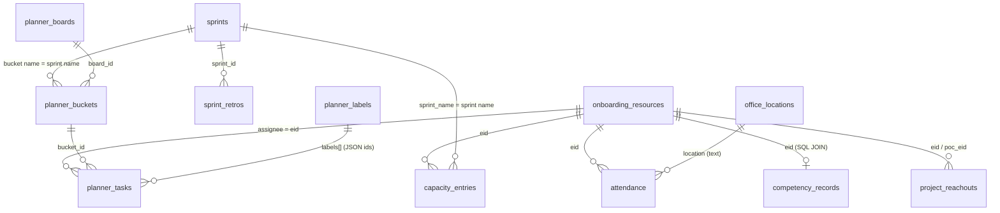

# Developer Hand-off: Song Bench Dashboard

Welcome aboard. This document walks you through how the app is built, what each feature does, and where its data lives. Read it once end to end, then keep it open as a map while you explore the code.

Written 2026-11-12, after the SQLite migration finished (Phase 8). When this document and the code disagree, **trust the code**, and please fix this file.

---

## 1. What this app is (in one paragraph)

The Song Bench Dashboard is an internal tool for the Accenture Song **bench**: people who are between client projects. Bench leads (POCs) use it to keep a roster of who is on the bench, track daily attendance, plan sprint work for each group, run sprint retros, record skill proficiency (myCompetency), track mock interviews and trainings, and log which projects each person has been put forward for (reachouts).

It has two halves:

| Half | Tech | Where | Runs on |
|---|---|---|---|
| Frontend | Angular 19 (standalone components, TypeScript strict) + Bootstrap 5 | `src/` | `http://localhost:4200` in dev |
| Backend | Express 5 (plain CommonJS JavaScript) + SQLite via `better-sqlite3` | `server/` | `http://localhost:3000` |

```
Browser (Angular, :4200)  ──HTTP/JSON──▶  Express API (:3000)  ──SQL──▶  server/data/dashboard.sqlite
```

There is **no login, no auth and no external services**. Everything is local.

---

## 2. Your first hour

```bash
npx npm@12 ci     # install. Must be npm 12; npm 10/11 try to compile better-sqlite3 and fail
npm run dev       # builds your local database if missing, then starts API (:3000) + Angular (:4200)
```

Open http://localhost:4200. You should see the sidebar and the Dashboard page. Click **Resources**: if the table fills in, both halves are working.

Then run the tests once so you know what "green" looks like:

```bash
npm run test:api       # backend tests (fast, use a temp copy of test data)
npx playwright test    # e2e tests in Chromium. Stop your own `npm run dev` first (port 3000 clash)
```

Need: **Node 22**. You do **not** need Visual Studio or a global Angular CLI.

---

## 3. Where to read more (and what is stale)

| Doc | Read it for | Trust level |
|---|---|---|
| `CLAUDE.md` (repo root) | The most accurate short summary of commands, architecture and rules | ✅ Current |
| `docs/backend-overview.md` | Every route, middleware order, and every frontend → API call with its payload | ✅ Current. Best backend reference |
| `docs/running-backend.md` | Setup, the database lifecycle (build / reset / back up), troubleshooting table | ✅ Current |
| `docs/found-bugs.md` | Known bugs (H/M/L), many deliberately *not* fixed | ✅ Current. Read before "fixing" odd behaviour |
| `docs/sqlite-migration-plan.md` | Why the database looks the way it does. "Decisions" table is settled; don't reopen | ✅ Historical, finished |
| `docs/server-restructure-plan.md` | Why the backend is split into routes/controller/service/repository | ✅ Historical, finished |
| `DASHBOARD_POLICIES.md` | **Business rules**: CL ranks, proficiency minimums, row colours, planner rules, reachout statuses | ✅ Current (storage and nav sections updated 2026-11-12) |
| `README.md` | Quick start, "Your data", a page-by-page feature list, the main API routes | ✅ Current (architecture, features and API sections updated 2026-11-12) |

---

## 4. Frontend tour (`src/app`)

### 4.1 The shell: no router

There is **no Angular Router**. The URL never changes. Instead:

- `AppComponent` (`app.component.ts`) is the shell: sidebar + main area.
- It has a property `activeView` (a string such as `'planner'`). It's saved in `localStorage['active-view']` so a refresh brings you back to the same page.
- `app.component.html` has a long `@if / @else if` chain that renders exactly one view component based on `activeView`.
- The **sidebar items come from the API** (`GET /api/dashboard`, hard-coded in `server/features/dashboard/dashboard.service.js`). Clicking one runs `selectNav()`, which maps the label (e.g. `"Project Reachouts"`) to a view key (`'reachout'`).

**To add a new page** you touch four places in the frontend: the `activeView` union + `validViews` array, the label → view map in `selectNav()` (and `isNavActive()`), a branch in the template, and the component import. Plus the nav item in `dashboard.service.js` on the server.

`AppComponent` uses `ViewEncapsulation.None`, so `app.component.css` is effectively **global CSS**. Be careful with selectors there.

### 4.2 Shared state: `SharedDataService`

`services/shared-data.service.ts` is the one place cross-page state lives:

| What | Why it matters |
|---|---|
| `onboardingResources` | The cached roster. Almost every page filters it by group to know "who is in this group" |
| `attendanceGroup` | The **global group filter** in the sidebar (saved in localStorage). Despite the name, every page uses it |
| `officeLocations` | Lookup list for RTO locations |
| `groupOptions` | Groups 1–5 and their labels (e.g. "Group 5 - AEM/Angular") |
| `apiUrl(path)` | **Always build API URLs with this.** On port 4200/4201 it prefixes `http://localhost:3000`; otherwise it returns the relative path, so the same build works when Express serves it |

Most views call `HttpClient` directly from the component (no per-feature data service), except Project Reachouts, which has `reachout-data.service.ts`.

Shared TypeScript interfaces are in `models/types.ts`. You'll see `Number(id)`, `Number(boardId)` etc. on server responses. **Keep those**: `[ngValue]` selects compare with `===`, and old seed data had string ids.

### 4.3 The pages

| Sidebar label | View key | Component | Talks to the API? |
|---|---|---|---|
| Dashboard | `dashboard` | `views/dashboard` | Yes, `GET /api/dashboard` (static content) |
| Resources | `onboarding` | `views/onboarding` | Yes, roster CRUD |
| Attendance Tracker | `attendance` | `views/attendance` | Yes |
| Planner (+ Sprint Retros submenu) | `planner`, `sprintretros` | `views/planner`, `views/sprint-retros` | Yes |
| myCompetency | `mycompetency` | `views/mycompetency` | Yes |
| Bench Trainings | `benchtrainings` | `views/bench-trainings` | ❌ Mock (fake service) |
| Group Trainings | `grouptrainings` | `views/group-trainings` | ❌ Mock (fake service + hard-coded tracks) |
| Mock Interview | `mockinterview` | `views/mockAssessmentSummary` | ❌ Browser localStorage only |
| Project Reachouts | `reachout` | `views/reachout` | Yes |
| POC how-to | `pochowto` | `views/pochowto` | ❌ Static HTML files, edits not saved |
| Initiatives, Reports, Resource tracking, Announcements, Settings | (stub keys) | Rendered by `AppComponent` as "coming soon" stubs | No |

What each real page does, briefly:

- **Resources (onboarding):** a form + paginated table of bench people (name, EID, hire/roll-in dates, project, CL level, group, skills, office). Deleting requires typing `DELETE`. Rules: `DASHBOARD_POLICIES.md` §6.
- **Attendance Tracker:** a month grid, one row per group member, one cell per day. Each cell is a status (`Present`, `RTO`, `Absent`, `SL`, `VL`…). Picking `RTO` asks for an office location. Clearing a cell deletes the record.
- **Planner:** Microsoft Planner-style. Each group has a **board** → **buckets** (one per sprint, auto-created when missing) → **tasks**. Three views: Grid, Board (kanban drag-and-drop with Angular CDK), and a Sprint Burndown chart. A **Capacity Plan** panel records per-person hours for the sprint and polls attendance + tasks every 2.5 s while open. Task comments and checklists live *inside* the task and are saved with the whole task. Rules: `DASHBOARD_POLICIES.md` §10–14.
- **Sprint Retros:** per sprint and group, cards in three columns: went well / didn't go well / improve.
- **myCompetency:** one row per group member with primary/secondary skill, proficiency (N/A, TBD, P1…P5) and retake dates. Rows turn green/yellow depending on whether the person meets the minimum for their CL level (`DASHBOARD_POLICIES.md` §1–5). Each field edit saves immediately.
- **Project Reachouts:** a table of "person X put forward for project Y", with a status pill (`CV Requested` → `Interview Scheduled` → `Passed`/`Failed`/`Pending Update`) editable inline. Rules: `DASHBOARD_POLICIES.md` §15.

### 4.4 Frontend-only features (important!)

These look real in the UI but **nothing reaches the server**:

| Feature | Where the data actually is | Note |
|---|---|---|
| Bench / Group Trainings progress | `of(...).pipe(delay(...))` in `*-progress.service.ts` | Comments in those services name the endpoints they'll eventually call (`/api/trainings-progress/:eid`, `/api/training-progress/:eid`). Neither exists |
| Group Trainings course list | `group-trainings-mock-data.ts` (only Group 5 has courses) | |
| Mock Interview / Assessment | `localStorage` in your browser | Each user sees only their own data |
| POC how-to content | `public/poc-howto/*.html`, loaded as text | Edits are kept in memory and lost on reload |

If you're asked to "make trainings persist", that means building new backend routes + a table. See §7.

---

## 5. Backend tour (`server/`)

### 5.1 Boot and request flow

- `server/server.js` only calls `app.listen()`.
- `server/app.js` only **composes** the app, in a fixed order that matters:
  1. `cors()` (open to all origins)
  2. `express.json()`
  3. every feature router
  4. `middleware/static.js`: the `/test` mount, the built Angular app (`dist/`), then a catch-all `GET` that returns `index.html`.

> ⚠️ Because of that catch-all, **a GET to an `/api/...` path that doesn't exist returns HTML with status 200**, not a 404. If your new endpoint "returns HTML", it's probably not registered.

- `server/config/index.js` reads the only two env vars, `PORT` (default 3000) and `DATA_DIR` (default `server/data`).

### 5.2 The four layers of a feature

Every feature lives in `server/features/<name>/` and follows the same chain. Let's follow `POST /api/sprints`:

```
sprints.routes.js       router.post('/api/sprints', controller.createSprint)        ← URL → function
sprints.controller.js   reads req.body, calls the service, picks the status code   ← HTTP in/out only
sprints.service.js      validates ("name, start and end are required"),            ← business rules
                        calls repository.write(store => store.insertSprint(...))
sprints.repository.js   module.exports = require('../../persistence/sqlite/sprints.store')
persistence/sqlite/sprints.store.js   runs the SQL (insertRow('sprints', ...))     ← the only place with SQL
```

Rules that keep this clean (enforced by tests in `test/api/guardrails/`):

- **Services never see SQL or files.** They call the store through `read(fn)` (read-only session) or `write(fn)` (one transaction; if `fn` throws, nothing is saved). See `persistence/sqlite/sqlite-store.js`.
- **Only `server/persistence/**` touches data.** Only a short, listed set of files may `require('fs')` or `better-sqlite3` (the `fs-boundary` test). Adding one is a design decision: ask first.
- **Features don't call each other.** The one exception is the competency store's SQL `JOIN` on the roster table.
- **Everything is synchronous.** `better-sqlite3` is sync, so there's no `async/await` in handlers.
- **No in-memory caches** of stored data; every request reads the database.
- `server/utils/fields.js` lists each collection's **writable fields** (unknown fields in a request are silently dropped) and the column order responses come back in.

### 5.3 Feature folders

| Folder | Routes | Store |
|---|---|---|
| `health` | `GET /api/health` → `{ ok: true }` | none |
| `dashboard` | `GET /api/dashboard` (nav, KPI cards, announcements…) | **hard-coded** in `dashboard.service.js` |
| `onboarding` | `/api/onboarding-resources` (GET/POST/PATCH/DELETE), `GET /api/skill-options` | `onboarding.store.js` |
| `sprints` | `/api/sprints`, `/api/sprint-retros` | `sprints.store.js` |
| `capacity` | `/api/capacity-entries` (GET, POST = upsert) | `capacity.store.js` |
| `attendance` | `/api/attendance` (GET/POST/PATCH/DELETE) | `attendance.store.js` |
| `lookups` | `GET /api/attendance-options`, `/api/office-locations`, `/api/planner-labels` (read-only) | `lookups.store.js` |
| `planner` | `/api/planner-boards`, `/api/planner-buckets`, `/api/planner-tasks`, `/api/deletion-logs` | `planner.store.js` |
| `reachouts` | `/api/project-reachouts` | `reachouts.store.js` |
| `competency` | `GET /api/competency-records?group=N`, `PATCH /api/competency-records/:eid` | `competency.store.js` |
| `legacy-tasks` | `/api/tasks` (unused by the UI) | JSON file `tasks.json` |
| `test-bench` | `/api/fruits` + static page at `/test/` (unused by the UI, a sandbox) | JSON file `test_bwd/db.json` |

Full route list with payloads and validation: `docs/backend-overview.md` §4 and §7.

### 5.4 Server behaviours that surprise people

- **Onboarding POST is an upsert by EID**: same EID → updates (200), new EID → creates (201).
- **Onboarding PATCH with a changed EID creates a new record** and leaves the old one (the client checks if the returned `id` changed).
- **EIDs are normalised** on onboarding and reachouts: lower-cased and everything from `@` removed (`Jane.Doe@accenture.com` → `jane.doe`). Not on capacity or competency (bug M9).
- If `projectDeployed` is `No`, the server forces `projectName = "Song Bench"` and a default POC.
- Dates: onboarding uses **`MM/DD/YYYY`**; sprints use **`YYYY-MM-DD`**.

---

## 6. The database

### 6.1 Where it comes from

```
server/data/db.json  ─┐                        (committed seed, never read at runtime)
server/data/custom-onboarding.json ─┤── npm run db:migrate ──▶ server/data/dashboard.sqlite  (gitignored, yours only)
                                    │   (persistence/sqlite/import.js)
```

- `dashboard.sqlite` is **local to your machine**. Every save you make in the UI goes there. Nobody else sees it and `git diff` stays clean.
- `npm run dev` / `npm run api` build it automatically if it's missing.
- **Reset** to the seed: stop the server, then `npm run db:migrate -- --force` (discards your edits).
- **Change shared data for the team**: edit the JSON seed (with your editor or Node, **never PowerShell**, which adds a BOM and breaks it), commit, and everyone runs `--force`.
- Schema: `server/persistence/sqlite/schema.sql`. Field ↔ column mapping (camelCase API ↔ snake_case columns): `persistence/sqlite/tables.js`.
- No ORM. IDs are `max(id)+1` integers. **No foreign keys** (a settled decision), so nothing stops orphans.

### 6.2 Tables and which feature owns them

| Table | Owned by (feature / page) | Written by the UI? | Key columns |
|---|---|---|---|
| `onboarding_resources` | Resources page; read by almost every page | Yes | `eid` (UNIQUE), `name`, `group_number`, `cl_level`, skills, dates |
| `attendance` | Attendance Tracker; read by Planner capacity | Yes | `eid`, `year`, `month`, `day`, `status`, `location` |
| `attendance_options` | Attendance dropdown values | No (seed only) | `label` |
| `office_locations` | RTO location picker | No (seed only) | `name` |
| `sprints` | Planner sprint selector, Sprint Retros | Yes | `name`, `start_date`, `end_date` |
| `sprint_retros` | Sprint Retros | Yes | `sprint_id`, `group_number`, `category`, `text` |
| `capacity_entries` | Planner → Capacity Plan | Yes | UNIQUE (`sprint_name`, `eid`), `cadence`, `admin`, `holiday` |
| `planner_boards` | Planner (one board per group) | No (seed only) | `group_number`, `name` |
| `planner_buckets` | Planner (one per sprint name) | Yes (auto-created) | `board_id`, `name`, `sort_order` |
| `planner_tasks` | Planner | Yes | `board_id`, `bucket_id`, `assignee` (an EID), `status`, dates; `labels`, `checklist`, `comments` are **JSON columns** |
| `planner_labels` | Planner label chips | No (seed only) | `name`, `color` |
| `deletion_logs` | Planner audit trail (task/comment deletes) | Yes (write-only from UI) | `type`, `task_id`, `deleted_by_eid` |
| `project_reachouts` | Project Reachouts | Yes | `eid`, `poc_eid`, `project_name`, `status`, `group_number` |
| `competency_records` | myCompetency | Yes | `eid` (UNIQUE), proficiencies, retake dates |

Not in SQLite: legacy `tasks.json` and the fruits test bench (`test_bwd/db.json`) stay as JSON files on purpose.

### 6.3 How the tables relate (logically; there are no foreign keys)

The **EID** (e.g. `jane.doe`) is the glue. The roster (`onboarding_resources`) is the hub; most other tables point at a person by EID, and at a group by `group_number`.



Things to notice:

- **Sprints are linked by *name*, not id**, to buckets and capacity. Renaming a sprint doesn't rename its bucket or capacity rows.
- **Groups (1–6)** appear as `group_number` on the roster, retros, boards and reachouts. "Who's in group 5" is always answered from the roster.
- **Most "join" work happens in the browser.** E.g. the Attendance page loads the roster from `SharedDataService`, filters by group, then matches attendance rows by EID. The only server-side join is myCompetency (`competency.store.js`: roster `LEFT JOIN competency_records`), which is why every group member appears even with no saved row.
- **No cascades.** Deleting a sprint leaves its retros, buckets and capacity; deleting a person leaves their attendance, tasks, etc. (bug M13). Writes don't check that the referenced board/sprint/person exists (M11).

### 6.4 Feature ↔ API ↔ table cheat sheet

| Page | Calls | Tables touched |
|---|---|---|
| Resources | `GET/POST/PATCH/DELETE /api/onboarding-resources`, `GET /api/office-locations` | `onboarding_resources`, `office_locations` |
| Attendance | `GET /api/attendance-options`, `GET/POST/PATCH/DELETE /api/attendance` | `attendance`, `attendance_options` (+ roster via shared cache) |
| Planner | boards, buckets, tasks, labels, sprints, capacity, attendance, deletion-logs | `planner_*`, `sprints`, `capacity_entries`, `attendance`, `deletion_logs` |
| Sprint Retros | `GET /api/sprints`, `GET/POST/PATCH/DELETE /api/sprint-retros` | `sprints`, `sprint_retros` |
| myCompetency | `GET /api/competency-records?group=N`, `PATCH /api/competency-records/:eid` | `competency_records` JOIN `onboarding_resources` |
| Project Reachouts | `GET/POST/PATCH/DELETE /api/project-reachouts` | `project_reachouts` (+ roster for names/groups) |
| Dashboard | `GET /api/dashboard` | none (hard-coded) |
| Trainings, Mock Interview, POC how-to | none | none |

---

## 7. How to make common changes

**Add a field to an existing feature** (e.g. a "notes" column on reachouts):
1. `schema.sql` + a migration in `persistence/sqlite/migrations.js` (existing databases must upgrade).
2. `persistence/sqlite/tables.js` (field ↔ column) and `server/utils/fields.js` (writable field + column order).
3. Service validation, if any.
4. `import.js` if the seed should carry it.
5. Frontend: `models/types.ts`, the component and template.
6. Tests: add new characterization cases; expect a `sqlite-trace` snapshot review.

**Add a new backend feature** (e.g. real trainings progress): new `server/features/<name>/` with routes → controller → service → repository, a new `persistence/sqlite/<name>.store.js` built with `createSqliteStore`, a table, and mount the router in `app.js` *before* `registerStaticFiles`. Then swap the `of(...)` in the frontend service for `HttpClient` calls via `sharedData.apiUrl()`.

**Add a new page:** see §4.1.

---

## 8. Testing

| Suite | Command | What it covers |
|---|---|---|
| API characterization | `npm run test:api` | Each test starts a fresh app on a temp copy of `test/fixtures/data/`. Snapshots record the response **and** what changed in the stored data |
| Guardrails | (part of `test:api`) | `fs-boundary`, `no-read-cache`, `store-interface`, `paths`, and `sqlite-trace` (snapshots the exact SQL each request runs) |
| E2E | `npx playwright test` | Chromium, one folder per page under `tests/`. Runs its own API on a temp copy of the seed, so it never touches your data |

**The snapshot rule:** existing snapshot entries should not change. If your change makes an old snapshot differ, that's a behaviour change: stop and discuss it. New test cases may add entries. `node test/tools/compare-snapshots.js --quiet` shows what was added/changed vs `HEAD`.

There are no Angular unit tests and no linter.

---

## 9. Team rules (the short version)

- **Don't change API behaviour** (routes, shapes, status codes, error messages) without agreement. Odd behaviour is often a *known, pinned* bug: check `docs/found-bugs.md` first. Log new bugs there rather than quietly fixing them.
- **No new or upgraded dependencies** without asking.
- **Run the full test suite** after each step. Don't move on with failures.
- **Keep file moves/renames in separate commits** from logic changes.
- **Never write the JSON data files with PowerShell.**
- **Never point tests at the real `server/data`**; always a temp `DATA_DIR`.
- **PRs target `develop`**, not `main`. There's no CI you can rely on (GitHub Actions is unavailable on this account): run tests locally before opening a PR.

---

## 10. Known issues worth knowing on day one

Full list in `docs/found-bugs.md`. The ones you're most likely to bump into:

| Bug | What you'll see |
|---|---|
| H1 | No auth, open CORS. Anyone on the network can call any endpoint |
| H4 | `PATCH /api/onboarding-resources/:id` blanks any field you don't send. The UI always sends the full form, so it's hidden |
| M6 | Changing an attendance cell from RTO to another status keeps the old location |
| M13 / M11 | No cascades, no referential checks (see §6.3) |
| M16 | `npm run build` fails Angular's bundle budget. `npm run dev` is fine |
| L1 | Unknown `/api` GETs return `index.html` with 200 |
| L19 | After editing myCompetency, CL 11/12 rows can show the wrong colour until reload |
| L20 | POC how-to: clicking Edit before a tab loads gets undone; makes one e2e spec flaky |

---

## 11. Glossary

| Term | Meaning |
|---|---|
| **Bench** | People not currently deployed to a client project |
| **EID** | Enterprise ID, the person's login name (`jane.doe`). The app's de-facto primary key for people |
| **POC** | Point of contact, a bench lead responsible for a group |
| **Group (1–6)** | A bench cohort by tech stack (e.g. Group 5 = AEM/Angular). The sidebar group filter scopes every page |
| **CL level** | Career level. Lower number = more senior (CL 6 highest, CL 12 most junior) |
| **P1–P5** | Skill proficiency levels used in myCompetency |
| **RTO** | Return to office: an attendance status that also records which office |
| **Roll-in / roll-off** | Joining the bench / leaving a project |
| **DN** | A yes/no flag on the roster (stored as `dn`) |
| **Seed** | The committed JSON (`db.json`, `custom-onboarding.json`) the local database is built from |
| **Characterization test** | A test that records what the code does today (right or wrong), so any change in behaviour shows up |

---

## 12. Suggested first week

1. Run the app; click through every page with the group filter on Group 5.
2. Read `DASHBOARD_POLICIES.md` §1–7 and §15 (business rules).
3. Trace one full request in the code: Sprint Retros "add card" → `sprint-retros.component.ts` → `POST /api/sprint-retros` → `sprints.service.js` `createRetro` → `sprints.store.js`. Open `dashboard.sqlite` in a SQLite browser (with the server stopped) and find your row.
4. Run `npm run test:api` and `npx playwright test`; open one snapshot file to see what a characterization test records.
5. Pick a small item (an L-severity bug the team agrees to fix, or anything in this document that turned out to be wrong) as your first PR to `develop`.
